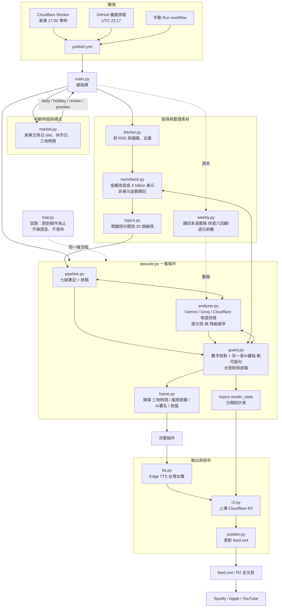

# 架構與維護手冊（美股科技收盤簡報）
> 版本 1.10.1　|　這份文件跟程式一起放在 repo 根目錄。改了模組關係或新增模組，請同步更新這份文件與 CHANGELOG.md。

## 1. 一集節目怎麼誕生（資料流）

**一句話**：先決定「今天是什麼日子」（market）→ 抓新聞並整理（fetcher、numcheck、topics）→ 寫稿並把關（pipeline、analyzer、guard、frame、episode）→ 變成聲音並發布（tts、r2、publish）。

## 2. 每個檔案做什麼（改哪裡可以達成什麼）

| 層 | 檔案 | 職責 | 想調整…就改這裡 |
|---|---|---|---|
| 觸發 | `.github/workflows/publish.yml` | 執行排程、環境變數、金鑰 | 發布時間備援、開關 `TWO_STAGE`/`AUDIT` |
| 觸發 | `worker/worker.js` | 美東 17:00 準時通知 GitHub | 觸發時間（夏令冬令自動） |
| 編排 | `main.py` | 串起全流程、標題、說明欄、全文頁 | 標題格式、說明欄、全文頁版面 |
| 時間 | `market.py` | 美東交易日、休市日、早收日、三地時間播報 | **每年核對假日表** |
| 資料 | `fetcher.py` | RSS 來源清單、備用網址、時間窗、去重 | 新增／移除新聞來源 |
| 資料 | `numcheck.py` | 金額改寫；成稿數字檢查 | 數字規則 |
| 資料 | `topics.py` | **分類關鍵詞、關注公司 WATCHLIST**、統計表 | 想多聽哪類新聞、關注哪些公司 |
| 稿件 | `pipeline.py` | 七組筆記的分工、筆記格式、統稿提示詞 | 哪個 AI 做哪組、每組幾則 |
| 稿件 | `analyzer.py` | 各家 AI 的呼叫、模型選擇、降級、提示詞（週末/休市） | 模型偏好、語氣規則 |
| 把關 | `guard.py` | 刪可疑句、AI 審稿、保底稿 | 審稿規則、保底門檻 |
| 框架 | `frame.py` | 開場、風險／健康提醒、署名、祝福 | 這些固定文字 |
| 編排 | `episode.py` | 把「主體→把關→框架→統計」串成一集 | 流程順序 |
| 週末 | `weekly.py` | 讀回本週舊稿 | 回顧／前瞻的素材 |
| 輸出 | `tts.py` `r2.py` `publish.py` | 語音、上傳、feed.xml | 語音、儲存、RSS |
| 測試 | `trial.py` + `trial.yml` | 試跑到稿件，不發布 | 試跑輸出內容 |

**線上資料（只在 GitHub 上，不要用本機檔案覆蓋）**：`feed.xml`、`episodes_queue.json`。

## 3. 防幻覺的位置（不可拆掉的設計）
1. 素材進 AI 前：`numcheck` 改寫金額、剔除非美元金額。
2. 筆記階段：背景／影響欄「素材沒寫就填無」。
3. 成稿後：`guard` 逐句核對數字 → **刪除**找不到來源的句子。
4. 另一家 AI 審稿 → **刪除**無依據的句子（不請 AI 改寫）。
5. 太短或 AI 全失敗 → 程式直接用筆記組稿（不經 AI 撰寫）。
6. 開場／結尾／署名／統計：全部由程式產生，不給 AI。
7. 統計表的「本集涵蓋」：統稿時 AI 在句尾加【N編號】標記，程式於把關（刪句）之後計數，再把標記全部移除（不會被念出來）。

## 4. 版本管理規則
- 每個 `.py` 檔頂端有 `__version__`；試跑 Summary 第一行會列出所有模組的版本，**上傳後先看這行確認沒有漏傳**。
- 版本號：`大.中.小`——新功能中版號加一（1.8→1.9），修錯小版號加一（1.8.0→1.8.1）。
- 每次改版：① 更新 `CHANGELOG.md`（改了什麼、為什麼、更動哪些檔案、怎麼回溯）② 更新受影響檔案的 `__version__` ③ 若模組關係變了，更新本文件。
- 試跑通過後，在 GitHub 建 Release 標籤（例如 `v1.8.1`），之後任何版本都能一鍵取回。
- 回溯：見 `ROLLBACK.md`。

## 5. 給 AI／新對話的接手說明（避免上下文遺失造成幻覺）
新開對話時，請先提供：`ARCHITECTURE.md`、`CHANGELOG.md` 最上面兩個版本，以及**這次要改的檔案原文**；不要讓 AI 憑記憶改檔案。
不可違反的原則：
- 不湊字數、不擴寫；素材沒有的事實、原因、數字、技術指標一律不寫。
- 公司名與人名保留英文原名；金額保留 million／billion／trillion，不換算成萬、億。
- 語氣中立，只描述可能性，不預判漲跌，不給買賣、配置建議。
- 非美元金額不引用。
- 不偽裝瀏覽器抓取被擋的網站；抓不到就略過。
- 修改前先看實際檔案；改完要跑試跑，並更新 CHANGELOG。

## 版本檢查（1.8.4）
`scripts/version.py` 是整個專案的發布版本與「這版應有的檔案版本」清單（EXPECT）。試跑摘要會比對，不一致就警告。每次發版必改：version.py、有動的檔案、CHANGELOG。

## 觀察列表與價格（1.9.0）
`watchlist.py` 是唯一要手動維護的清單（代號、新聞用名稱、類型、區塊）。`topics.py` 用它做新聞選材優先；`prices.py` 用它算 21 日高低點與 ETF 趨勢（目前只在試跑顯示，不進節目稿；確認資料來源可靠後才接進 episode）。

## 價格動向與更新紀錄（1.10.0）
- `prices.py`：日更集數在主體後加一段程式寫的價格動向（SPY 預檢、日期核對、失敗就略過）；不經 AI、不進防幻覺審稿。
- `updates.py`：讀者版更新紀錄。每次發版加一筆，R2 文稿頁累積顯示，發版後 3 天內口播最新一句。
